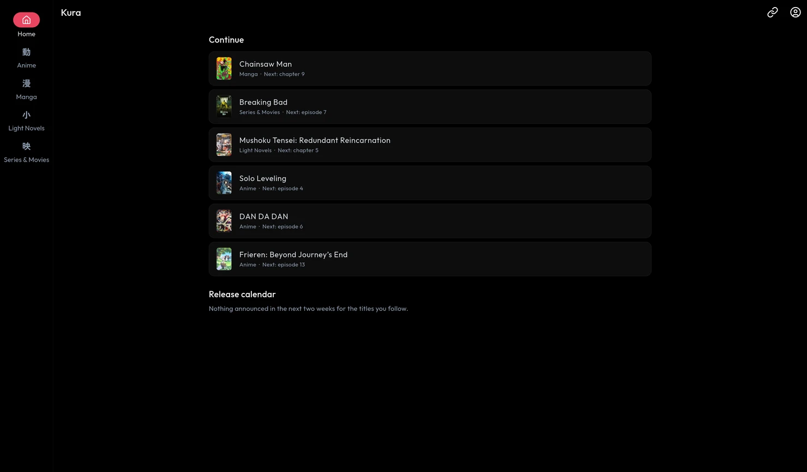
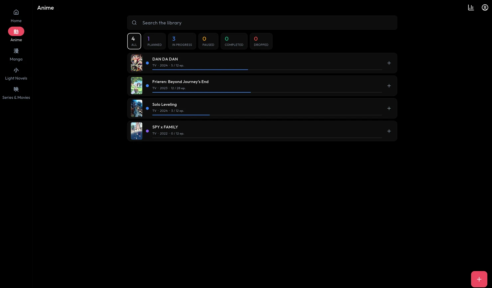
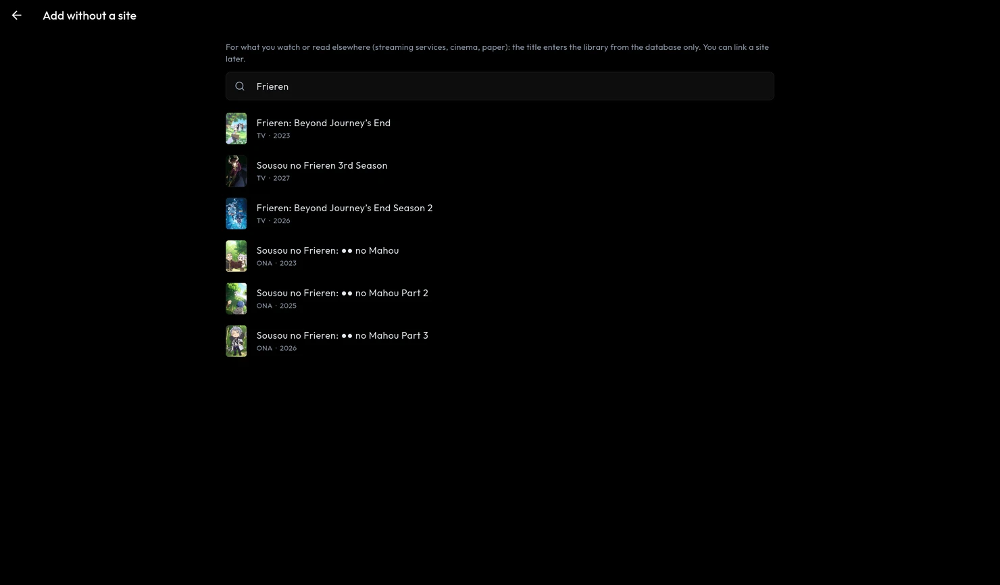
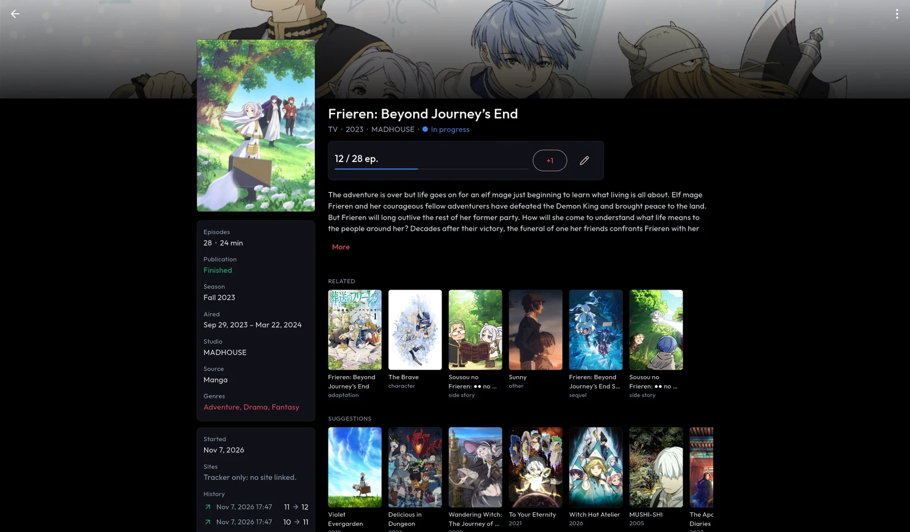
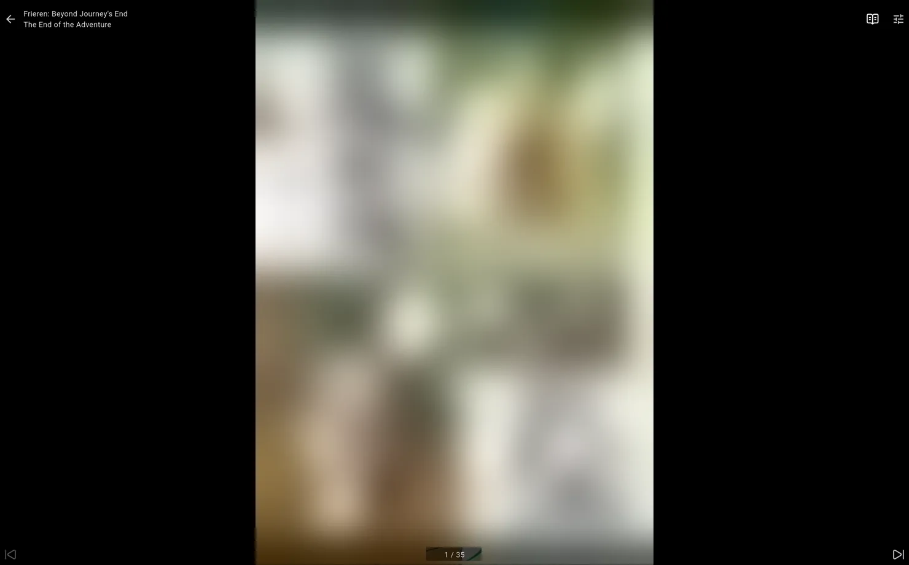
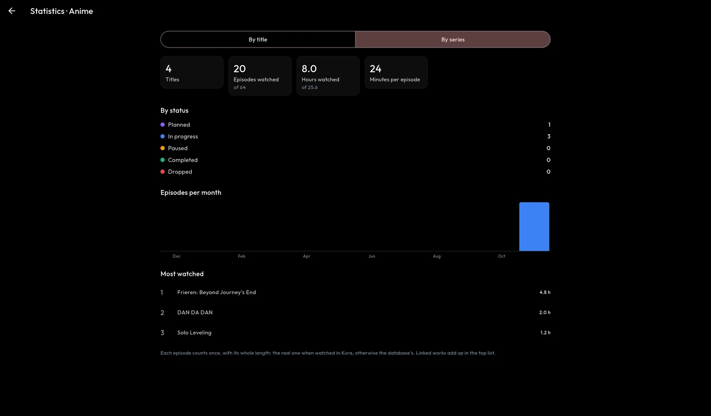
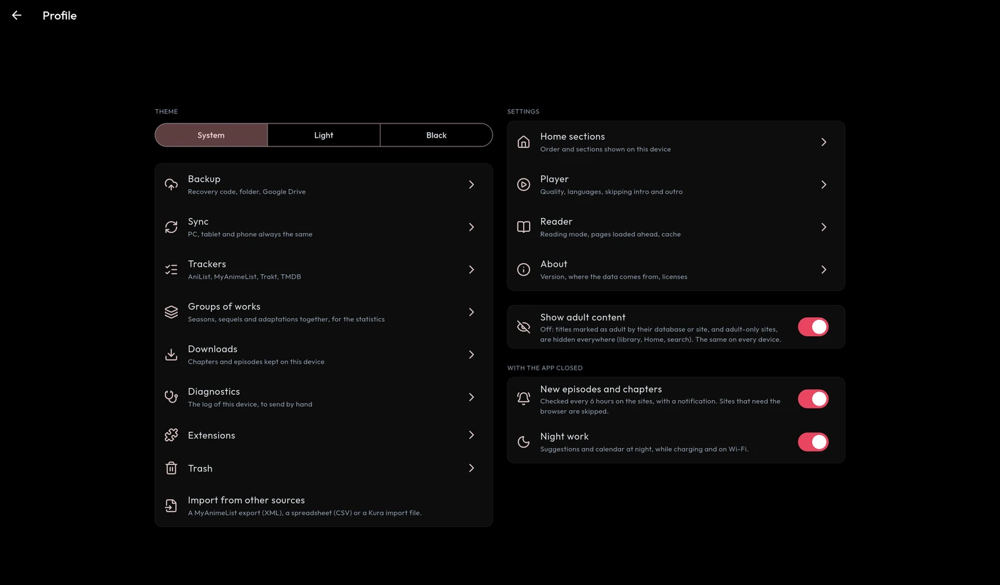

# Getting started with Kura

A short tour of the app. Screenshots are from an Android tablet; the Windows app
looks the same.

## Home

**Home** shows what you are following, with the next episode or chapter, and the
calendar of new releases for your titles. Tap a title to open it. The sections can
be reordered in **Profile › Home sections**.

## Your library

On the left there is one library per type: **Anime**, **Manga**, **Light Novels**,
**Series & Movies**. The counters on top filter by status (planned, in progress,
paused, completed, dropped). The **+** on a row adds one episode or chapter.

Kura sets the status by itself from your progress: a title becomes *in progress*
when you start it and *completed* when you reach the end.

## Adding a title

Tap the **+** button at the bottom right of a library:

- **Search the sites**: if you installed extensions, find the title on a site and
  watch or read it inside Kura.
- **Add without a site**: for what you watch or read elsewhere (streaming services,
  cinema, paper). The title comes from AniList (anime, manga, light novels) or TMDB
  (series and movies). You can link a site later.
- **Add by hand**: for anything not in the databases.

## A title

The title page has your progress (**+1** to add an episode, the pencil to set any
number), the details from the database, related works (sequels, adaptations) and
suggestions. With a site linked, the list of episodes or chapters appears here, and
a tap starts the player or the reader.

The **⋮** menu on top changes the status, the match with the database, merges two
copies of the same work, or moves the title to the trash.

## Watching and reading

The **player** opens full screen. Tap the picture to show the controls: play and
pause, 10 seconds back and forward, the previous and next episode, and the bar to
jump anywhere. The button at the top right sets quality and language. Kura
remembers where you stopped and marks the episode as watched when you reach the end.

The **reader** shows one chapter. The counter at the bottom is the page, the arrows
at the corners go to the previous or next chapter, and the buttons at the top right
change the reading mode and the look of the page. When you reach the last page the
chapter counts as read.

## Statistics

The chart icon on top of a library opens its statistics: how many titles, episodes
and hours, by status, by month, and your most watched works. **By series** counts
seasons and sequels of the same work together.

## Profile

The person icon on top opens **Profile**, where everything else lives:

- **Backup** and **Sync**: keep the **recovery code** in a safe place, then choose
  a backup folder, Google Drive or [your own server](server).
- **Trackers**: two-way sync with AniList, MyAnimeList and Trakt, and your TMDB key
  for series and movies.
- **Extensions**: add a catalog by its address, or install an extension from a
  `.zip` file. Only install extensions from people you trust.
- **Trash**: titles stay there 30 days and can be restored.
- **Import from other sources**: a MyAnimeList export (XML) or a spreadsheet (CSV).

Something not working? **Profile › Diagnostics** shows the log of the device, to copy
into a [bug report](https://github.com/PROPULSORE/kura/issues/new/choose). It never
contains keys, tokens or your recovery code.
